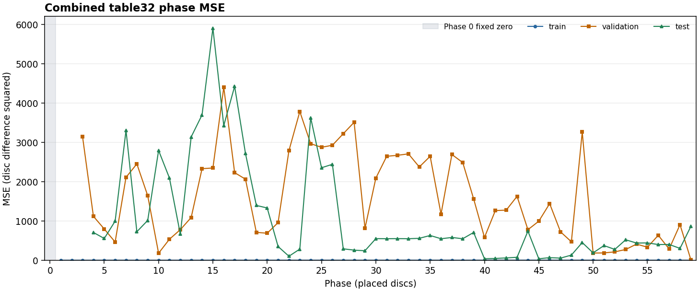
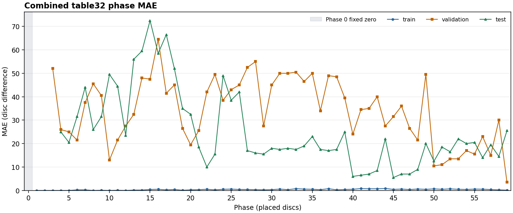

# 0056 結合候補の phase 別損失と被覆

対象は `0056-20261119-combined-01` の全60 phaseを含む候補。候補全体のdigestは
`66d4aff7ce3d5a710b64a604c220735c741278b167afba92e6de9b5a2885da4e`。
保存済み独立対局はS0に対して20局で6点、判定は `not-improved-at-pilot-scale` だった。
Playgroundで弱く感じたという観察は、調査のきっかけとして扱う。





## 読み方

[report.json](report.json) は、各phaseとsplitの行数、石差の絶対誤差・二乗誤差、その平均、
教師の由来、手番、抽出行digest、元rootとmanifest digestを記録する。実際の結合済み
整数重みを使い、各局面の65 featureを手番視点で求め、raw32を合計してから丸め、
値を±64に収めた。保存された各抽出行の教師値も同じ手番視点の石差で、
この候補のデータではすべて自前S0の終局値（`project-owned-s0-terminal`）に由来する。

図の空白とJSONの `null` は欠測を表す。trainは783局面でphase 0が欠測、
validationは116局面でphase 0–2が欠測、testは113局面でphase 0–3が欠測だった。
phase 0の重みは暫定固定ゼロ。validation/testはどのphaseも最大3局面だった。
一方、trainの観測誤差は図の下端近くに並ぶ。この標本では、trainの当てはまりから
未見局面への汎化やエンジンの強さを推定できない。phase間では局面分布も異なる。
ここで参照したtest局面は、後続の最終holdoutの選定から除外する。

| Phase | Train 件数 / MSE / MAE | Validation 件数 / MSE / MAE | Test 件数 / MSE / MAE |
| ---: | ---: | ---: | ---: |
| 0 | 0 / 欠測 / 欠測 | 0 / 欠測 / 欠測 | 0 / 欠測 / 欠測 |
| 10 | 12 / 0 / 0 | 2 / 178 / 13 | 2 / 2792.5 / 49.5 |
| 40 | 20 / 0.5 / 0.5 | 2 / 580 / 24 | 2 / 37 / 6 |
| 59 | 16 / 0.125 / 0.125 | 2 / 12.5 / 3.5 | 2 / 860.5 / 25.5 |

phase 10のtrainが観測した学習parameterは、全612,425アドレス中621だった。
`runtime_feature_occurrences` は評価時に実際に参照されるインデックスを、
`training_parameter_occurrences` は学習時に逆順共有分を加えたインデックスを集計する。
各出現頻度表のキーは1アドレスあたりの出現回数、値はその回数で現れたアドレスの個数。
`unobserved_in_train_parameters` は各splitで実際に参照した中で、逆順共有を含めても
trainが観測しなかったアドレスの個数。phase 10でvalidationに36、testに38あった。

## 再生成と照合

Python環境にMatplotlibを用意する。保存画像は3.10.8で生成した。
リポジトリ直下から元runの絶対パスと出力先を指定する。

```sh
python3 tools/reversi-ai-training/table32_analyze.py \
  --combined-root /path/to/0056-20261119-combined-01 \
  --output-dir /tmp/table32-0056-analysis
```

結合manifestに記録された全元rootを既定で使用する。移動した場合は各rootを
`--source-root /path/to/source` で渡す。結合元は
`0056-20261119-early-01`、`0054-20261114-phase10-19`、`0054-20261114-phase20-29`、
`0054-20261114-phase30-39`、`0054-20261111-partial-01`、`0054-20261114-phase50-59`。
検証receipt、抽出行digest、全phaseの重みを照合してから別ディレクトリに出力する。
最終float重みの参考値が必要な場合は `--include-float` を指定する。
これは最終状態の重みから再計算した、連続値を±64に制限した石差の診断。

別計算でphase 0、10、40、59の件数・誤差合計を照合した。例えばphase 10の
誤差（教師値 − 予測値）はvalidationが10と−16、testが68と31だった。
この分析に用いた候補・元runは読み取り専用で、保存済み原本は引き続き参照できる。
[0056結合結果の保存先](https://github.com/yoskeoka/reversi-adventure/pull/307)
